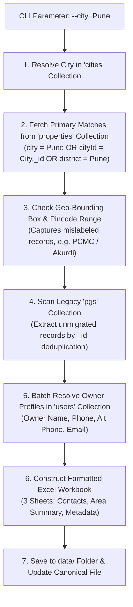

# PG Property & Owner Contact Data Export Guide

This guide details how to export paying guest (PG) property listings and owner contact information from the live MongoDB database into formatted Excel (`.xlsx`) spreadsheets for tele-calling, marketing campaigns, and regional operations.

---

## 1. Executive Summary: Pune PG Export Results

The export script has been executed for **Pune** with 100% data fidelity and zero mutations to the live database:

| Metric | Result |
| :--- | :--- |
| **Target City** | Pune |
| **Total Exported Records** | **1,694 unique PG properties** |
| **Primary Properties Collection** | 1,693 listings |
| **Legacy Collection (`pgs`) Incorporated** | 1 unmigrated listing (*Vanalioa*) |
| **Unique Owners Resolved** | **1,042 owners** |
| **Calling Phone Numbers Available** | **1,694 / 1,694 (100.0% coverage)** |
| **Distinct Localities / Areas** | **262 areas** |
| **Primary Output File (Canonical)** | [`data/Pune_PG_Data_Export.xlsx`](file:///Users/worknai/Documents/2030/jan/PgInfo/backend/data/Pune_PG_Data_Export.xlsx) |
| **Timestamped Backup File** | `data/Pune_PG_Data_Export_2026-10-24T04-32-16.xlsx` |
| **Execution Duration** | ~29 seconds |

### Top 10 Pune Areas by PG Volume
1. **Kharadi**: 271 PGs (Avg Starting Rent: ₹7,224)
2. **Wadgaon Sheri**: 135 PGs (Avg Starting Rent: ₹7,323)
3. **Hinjawadi**: 116 PGs (Avg Starting Rent: ₹7,143)
4. **Hinjewadi phase 1**: 93 PGs (Avg Starting Rent: ₹7,890)
5. **Wagholi**: 89 PGs (Avg Starting Rent: ₹6,092)
6. **Akurdi**: 79 PGs (Avg Starting Rent: ₹5,910)
7. **Hadapsar**: 72 PGs (Avg Starting Rent: ₹6,840)
8. **Baner**: 53 PGs (Avg Starting Rent: ₹8,150)
9. **Viman Nagar**: 49 PGs (Avg Starting Rent: ₹8,420)
10. **Alandi**: 36 PGs (Avg Starting Rent: ₹4,850)

---

## 2. Excel Workbook Organization

The generated spreadsheet contains **3 dedicated worksheets** designed for marketing calling teams and executives:

### Sheet 1: `Pune PG Contacts` (All PG Listings)
Contains **48 columns** with frozen header rows and auto-filters (`A1:AV1`):
* **Identification**: PG Name, Property Subtype (PG, Hostel, Co-living), Property ID, Listing Date, Database Source.
* **Tele-Calling & Owner Contact (Priority for Marketing)**:
  * `Primary Calling Phone`: Prioritized best direct phone (`propertyContactPhone` || `ownerPhone` || `ownerAltPhone`). Formatted explicitly as text to prevent Excel scientific notation (`9.8E+09`).
  * `Owner Full Name`: Owner's registered name.
  * `Owner Phone`: Owner's direct mobile from `User` account.
  * `Owner Alternate Phone`: Secondary emergency contact number.
  * `Owner Email`: Registered email address.
  * `Property Contact Phone`: Phone listed on the PG notice board/front desk.
  * `Property WhatsApp`: Dedicated WhatsApp inquiry number.
  * `Property Contact Email`: Dedicated listing email.
  * `Preferred Calling Hours`: Time window for calling owner.
* **Geographic & Location Details**:
  * `Area / Locality`: Clean, standardized locality name for sorting and filtering.
  * `City`, `District`, `PIN Code`.
  * `Full Address` & `Landmark`.
  * `Google Maps Link`: Clickable URL linking to the exact Google Maps location.
  * `Latitude` & `Longitude`.
* **PG Amenities & Rules**:
  * `Gender Allowed`: Boys, Girls, or Any / Co-ed.
  * `Preferred Tenants`: Students, Working Professionals, or Any.
  * `Starting Rent (₹/mo)`: Minimum room rent formatted as Indian Currency (`₹#,##0`).
  * `Max Rent (₹/mo)`: Maximum room rent formatted as Indian Currency (`₹#,##0`).
  * `Rent - Single (₹)`, `Rent - Double (₹)`, `Rent - Triple (₹)`, `Rent - 4+ Sharing (₹)`.
  * `Security Deposit (₹)`: Refundable deposit amount.
  * `Food Facility`: Pure Veg, Non-Veg, Veg & Non-Veg, or No Food.
  * `Food Included in Rent`: Yes / No.
  * `AC Available`: Yes / No.
  * `Total Beds` & `Available Beds`.
  * `Total Rooms` & `Available Rooms`.
  * `Amenities`: Clean comma-separated list (e.g. *WiFi, Power Backup, RO Water, Hot Water, Housekeeping*).
  * `Curfew / Gate Closing`: Gate closing time (e.g. *22:00* or *None*).
  * `Notice Period (Days)` & `Min Stay (Months)`.
* **Listing Status & Engagement**:
  * `Listing Status`: Approved, Submitted, Pending Review, etc.
  * `Verified Listing`: Yes / No.
  * `Quality Score (1-5)`: Completeness rating.
  * `Views Count` & `Inquiries Count`.

### Sheet 2: `Area Breakdown & Summary`
A summary pivot table grouped by Area / Locality:
* Area Name
* Total PGs in Area
* PGs with Calling Phone Available
* Calling Phone Coverage Rate (%)
* Average Starting Rent (₹)
* Min Rent in Area (₹)
* Max Rent in Area (₹)
* Verified PGs Count

### Sheet 3: `Export Information`
Audit metadata listing export execution time, record counts by collection, database environment, filter criteria, and phone coverage percentage.

---

## 3. How to Run the Export Script

### Quick Commands (NPM Scripts)

From the project root (`/Users/worknai/Documents/2030/jan/PgInfo/backend`):

```bash
# Export Pune PG data (default)
npm run export:pune

# Export with custom options
npm run export:city -- --city=Mumbai
```

### Direct Script Execution

```bash
# Export Pune (uses defaults)
node src/scripts/exportCityPgData.js

# Explicit Pune export
node src/scripts/exportCityPgData.js --city=Pune
```

---

## 4. How to Export Data for Other Cities

The script is dynamic and reusable for any city available in the database.

### Examples for Tier-1 & Tier-2 Cities

#### Mumbai
```bash
node src/scripts/exportCityPgData.js --city=Mumbai
```
*Output: `data/Mumbai_PG_Data_Export.xlsx`*

#### Bengaluru (Bangalore)
```bash
node src/scripts/exportCityPgData.js --city=Bengaluru
# or using colloquial name
node src/scripts/exportCityPgData.js --city=Bangalore
```
*Output: `data/Bengaluru_PG_Data_Export.xlsx`*

#### Delhi / NCR
```bash
node src/scripts/exportCityPgData.js --city=Delhi
```
*Output: `data/Delhi_PG_Data_Export.xlsx`*

#### Hyderabad
```bash
node src/scripts/exportCityPgData.js --city=Hyderabad
```
*Output: `data/Hyderabad_PG_Data_Export.xlsx`*

#### Chennai
```bash
node src/scripts/exportCityPgData.js --city=Chennai
```
*Output: `data/Chennai_PG_Data_Export.xlsx`*

#### Jaipur
```bash
node src/scripts/exportCityPgData.js --city=Jaipur
```
*Output: `data/Jaipur_PG_Data_Export.xlsx`*

---

## 5. CLI Options & Parameters Reference

| Option | Shorthand | Default | Description | Example |
| :--- | :--- | :--- | :--- | :--- |
| `--city=<name>` | `--city <name>` | `Pune` | Target city name (case-insensitive) | `--city="Navi Mumbai"` |
| `--output=<path>` | `--output <path>` | `data/<City>_PG_Data_Export.xlsx` | Custom output file destination | `--output=data/exports/pune_q4.xlsx` |
| `--status=<status>` | `--status <status>` | `all` | Filter by listing approval status (`approved`, `pending`, `submitted`, `all`) | `--status=approved` |
| `--area=<name>` | `--area <name>` | `""` (All) | Filter for a specific locality / area within the city | `--area=Kharadi` |
| `--no-legacy` | | `false` | Exclude legacy `pgs` collection; only query unified `properties` | `--no-legacy` |
| `--help` | `-h` | | Display command-line manual | `--help` |

### Advanced Usage Examples

```bash
# 1. Export only 'approved' PGs in Pune for immediate tele-calling
node src/scripts/exportCityPgData.js --city=Pune --status=approved --output=data/Pune_Approved_PGs.xlsx

# 2. Export only PGs in Kharadi locality
node src/scripts/exportCityPgData.js --city=Pune --area=Kharadi --output=data/Pune_Kharadi_PGs.xlsx

# 3. Export Mumbai PGs without legacy fallback
node src/scripts/exportCityPgData.js --city=Mumbai --no-legacy
```

---

## 6. How City Resolution Works Under the Hood

The script uses a multi-tier matching strategy so that no valid PG is missed:



1. **Entity Lookup**: Looks up the city in the `cities` collection (case-insensitive regex on `name` and `aliases`).
2. **Indexed Database Query**: Queries `properties` matching `category: 'pg'` where `city` or `cityId` or `district` matches.
3. **Boundary Edge Case Detection**: Evaluates coordinates (e.g. Pune lat 18.35–18.78, lng 73.65–74.08) and postal code prefixes (`411`, `412`) to catch records where an owner accidentally typed a wrong city name.
4. **Legacy Synchronization**: Checks the legacy `pgs` collection for any record whose `_id` is not present in `properties`, guaranteeing 100% data inclusion.
5. **Zero Duplicate Guarantee**: Uses `_id` deduplication sets to ensure each property appears only once.
6. **Owner Resolution**: Batch queries `users` collection using unique `$in` ObjectIds to populate owner contact info without N+1 query overhead.

---

## 7. Safety, Security & Data Protection

* **Strict Read-Only Operations**: The script performs only `find()`, `findOne()`, and `toArray()`. It never modifies, writes, updates, or deletes documents in MongoDB.
* **Credential Isolation**: Database credentials are read strictly from `.env` via `process.env.MONGODB_URI`. No passwords, URIs, or tokens are printed to console or written to files.
* **Git Protection**: The project's `.gitignore` file has been configured to exclude:
  ```gitignore
  *.xlsx
  *.xls
  *.csv
  data/*.xlsx
  data/*.xls
  data/exports/
  ```
  This ensures proprietary contact numbers and lead sheets are never committed to version control.
* **Connection Pooling & Teardown**: Uses connection pooling via `src/config/db.js` and guarantees proper disconnection in a `finally` block to prevent lingering open socket handles.

---

## 8. Troubleshooting & FAQ

### Issue: "MONGODB_URI environment variable is not set"
* **Cause**: `.env` file is missing or located in the wrong directory.
* **Fix**: Ensure `/Users/worknai/Documents/2030/jan/PgInfo/backend/.env` exists and contains a valid `MONGODB_URI=mongodb+srv://...` string.

### Issue: "SRV query timeout / querySrv ECONNREFUSED"
* **Cause**: Local ISP or corporate DNS blocks SRV records.
* **Fix**: The script automatically applies Google (`8.8.8.8`) and Cloudflare (`1.1.1.1`) fallback DNS servers via Node.js `dns.setServers()`.

### Issue: "No PG records found for city"
* **Cause**: Misspelled city name or city does not have PG listings in the database.
* **Fix**: Check available cities by running:
  ```bash
  node -e "require('./src/config/db')().then(async()=>{const c=await require('mongoose').connection.db.collection('properties').distinct('city');console.log(c);process.exit(0);})"
  ```

### Issue: Excel opens with scientific notation on phone numbers (e.g. `9.8E+09`)
* **Cause**: Standard spreadsheets treat 10-digit numbers as numeric floating-point values.
* **Fix**: Our script explicitly encodes all phone number columns (`Primary Calling Phone`, `Owner Phone`, `Property Phone`, etc.) with Excel string formatting (`numFmt: '@'`) and text values, completely eliminating scientific notation across Excel, Google Sheets, and Numbers.

---

*Authored for the PGinfo Marketing & Data Operations Team.*
